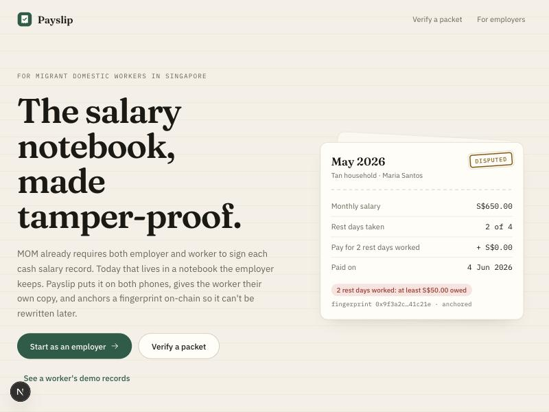
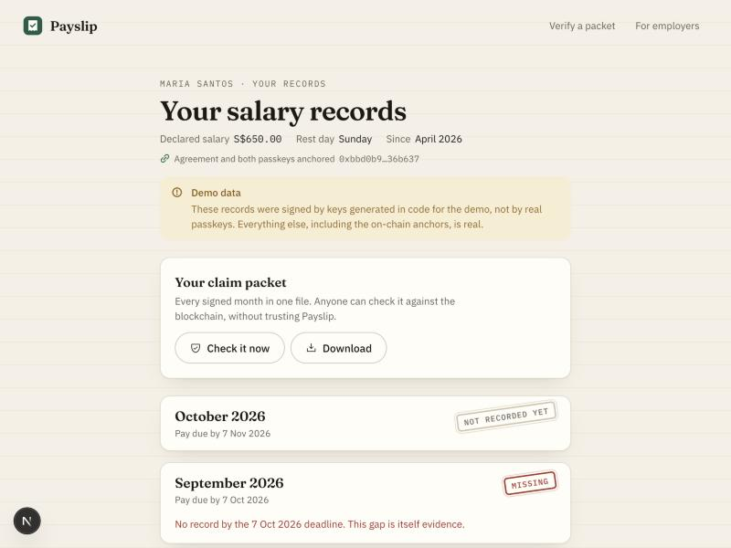
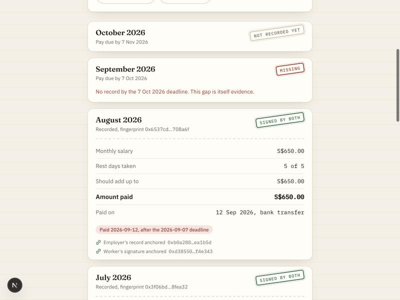
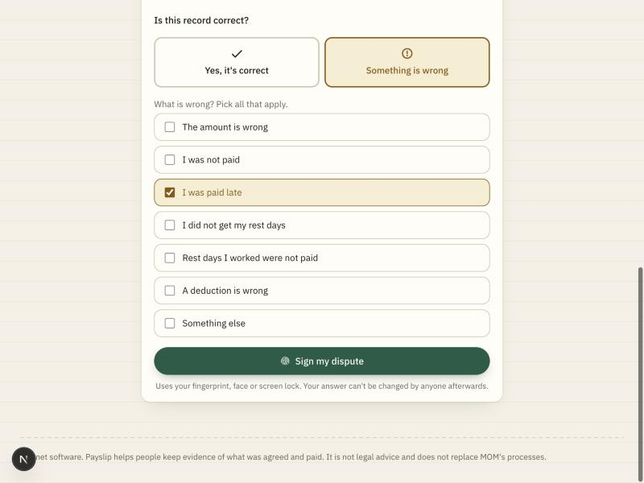
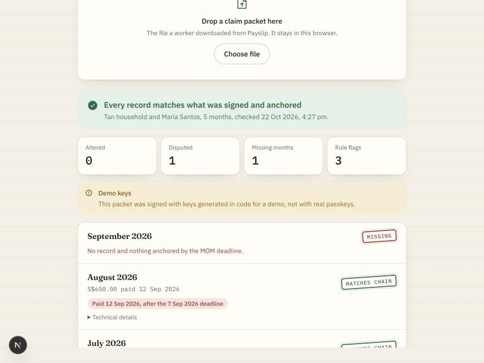
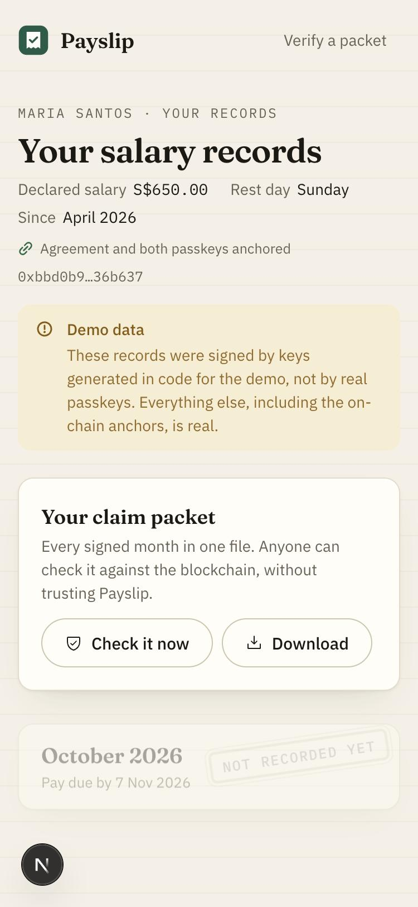
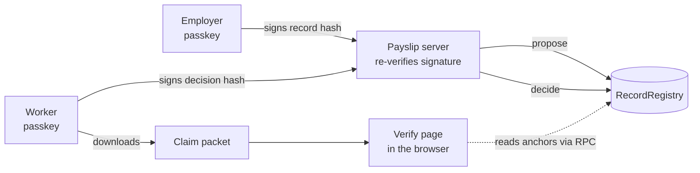
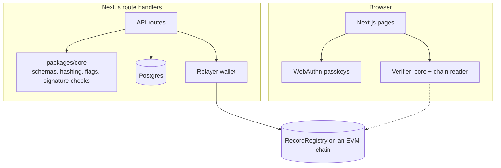

# Payslip


**The salary notebook, made tamper-proof.**

Singapore's Ministry of Manpower (MOM) requires the employer and the migrant domestic worker to both sign each cash salary record.
Today that record lives in a notebook the employer keeps, so in a dispute it is the employer's word against the worker's.
Payslip puts the record on both phones, has both people sign it with a passkey, gives the worker their own copy, and anchors a fingerprint of every record on-chain so nobody can rewrite it later.

Live frontend: not deployed yet · Backend: runs locally · Contract: [`RecordRegistry` on Base Sepolia](https://sepolia.basescan.org/address/0x2efdab0a0a7fe2bffd8750d51c53613704e45b93).

[See it in one command](#see-it-in-one-command) · [The one rule](#the-one-rule) · [Architecture](#architecture) · [What's real vs pending](#whats-real-vs-pending---the-honesty-table) · [Tests](#tests) · [The one-flow demo](#the-one-flow-demo)

Built for the Web3 for Social Good Hackathon 2026 (SMU, GSR Foundation and the University of Málaga), Tech Track.
MIT licensed.
Payslip is testnet software.
It keeps evidence of what was agreed and paid; it is not legal advice, it does not move money, and it does not replace MOM's processes.

## Table of contents

- [See it in one command](#see-it-in-one-command)
- [Screenshots](#screenshots)
- [The one rule](#the-one-rule)
- [What Payslip does](#what-payslip-does)
  - [Co-signed monthly records](#co-signed-monthly-records)
  - [MOM rule checks](#mom-rule-checks)
  - [Disputes that cannot be erased](#disputes-that-cannot-be-erased)
  - [A claim packet the worker owns](#a-claim-packet-the-worker-owns)
  - [Verification without trusting Payslip](#verification-without-trusting-payslip)
- [Architecture](#architecture)
- [Component by component](#component-by-component)
- [Safety, enforced in code](#safety-enforced-in-code)
- [How it uses the chain](#how-it-uses-the-chain)
- [Engineering decisions and the hard problems](#engineering-decisions-and-the-hard-problems)
- [What's real vs pending - the honesty table](#whats-real-vs-pending---the-honesty-table)
- [Tests](#tests)
- [Run it locally](#run-it-locally)
- [The one-flow demo](#the-one-flow-demo)
- [Configuration](#configuration)
- [Deploy](#deploy)
- [Project layout](#project-layout)
- [Tech stack, credits, roadmap](#tech-stack-credits-roadmap)
- [Disclaimer and license](#disclaimer-and-license)

## See it in one command

Postgres, the local chain and the contract (needs Docker, Node 24, pnpm and Foundry):

```bash
cd Payslip
pnpm install && cp .env.example .env && pnpm db:up && pnpm db:migrate
pnpm chain  # leave running: a local Anvil node on :8545
```

In a second terminal, deploy the contract, seed six months of demo history, and start the app:

```bash
cd Payslip
pnpm contracts:build && pnpm deploy  # copy the printed address into NEXT_PUBLIC_REGISTRY_ADDRESS in .env
pnpm seed  # prints a demo worker link and a demo employer link
pnpm dev  # http://localhost:3020
```

Open the demo worker link from `pnpm seed`, press *Check it now*, and the verify page re-hashes every month in your browser and reads the anchors straight from the chain.
To try the live flow, open `/start`, create an employer passkey, then open the invite link in another browser profile and create the worker's passkey.

## Screenshots













## The one rule

**A record only counts if both people signed exactly that record, and anyone can check it without asking Payslip.**

1. *Signatures cover the content.* The WebAuthn challenge for every signature is the keccak256 fingerprint of the canonical record (or of the worker's decision), so a passkey signature proves approval of exactly those bytes.
2. *The server re-checks before it stores.* `proposeRecord` and `decideRecord` verify each passkey signature against the key bound to that employment and reject anything else, before the relayer anchors it.
3. *Verification needs nothing from Payslip.* The verify page recomputes the hashes, checks the P-256 signatures with WebCrypto, and reads `RecordRegistry` through the chain RPC from the browser. It always uses the site's configured registry, never the address a packet claims.

## What Payslip does

### Co-signed monthly records

The employer records the month: salary, weekly rest days taken or worked, rest-day pay, deductions, the amount paid, the date and the method.
They sign it with their passkey and it goes to the worker.

```text
record -> canonical JSON -> keccak256 ("payslip.record.v1") -> passkey signature (challenge = hash) -> RecordRegistry.propose
```

The record, the signature and the anchor transaction are all real; the server refuses a record whose signature does not verify.

### MOM rule checks

Each month is checked against the MOM rules visible in the record itself, both while the employer types and on every view.

| Flag | Rule |
| --- | --- |
| `MISSING` | No record by 7 days after the end of the month (MOM's payment deadline) |
| `PAID_LATE` | Paid after that deadline |
| `NO_REST_DAY` | No rest day in the month (at least one cannot be compensated away, unless deferred) |
| `REST_DAY_PAY_SHORT` | Less than one day's salary (monthly salary / 26) for each rest day worked |
| `UNDERPAID` | Paid less than the record's own total |
| `BELOW_DECLARED_SALARY` | Salary below what was declared to MOM |
| `DEDUCTIONS` | Deductions present (shown for review) |

The salary / 26 rule matches MOM's own worked example ($650 salary, 2 rest days worked, $50 owed), which is a unit test.

### Disputes that cannot be erased

The worker answers each record on their own phone: *Yes, it's correct*, *I'm signing because I was told to* (under protest), or *Something is wrong* with one or more reasons.
The answer is its own signed object, fingerprinted and anchored with `RecordRegistry.decide`.
Entries are append-only, so a dispute stays on-chain even if an acknowledgement is added later.

### A claim packet the worker owns

The worker can download every signed month as one JSON file, or press *Check it now* to open it in the verifier.
The packet holds the employment, both public keys, every record, every signature and every decision, so it can be checked even if Payslip disappears.

### Verification without trusting Payslip

`verifyPacket` reports, per month, whether the record matches the chain, was altered, or was never anchored.
It also lists months that are missing after their deadline and months that exist on-chain but were left out of the file.
On an altered month it skips the rule checks, because the numbers in that copy cannot be trusted.

## Architecture

Two decisions shape everything else:

- *Only fingerprints go on-chain.* No names, salaries or IDs are ever written to the chain, only keccak256 hashes of salted canonical JSON and of the passkey public keys.
- *Passkeys, not wallets.* Workers and employers sign with the fingerprint, face or screen lock they already use. A relayer pays gas, and it cannot forge anything because every hash is backed by a signature anyone can verify.





| Tier | Runs | Can it move funds? | Responsibility |
| --- | --- | --- | --- |
| Browser | The worker's and employer's own devices | No | Creates passkeys, signs record and decision hashes, verifies packets |
| Server | Next.js route handlers | No | Validates and re-verifies signatures, stores records, asks the relayer to anchor |
| Relayer | Server-side key | Only its own gas | Sends `openEmployment`, `propose` and `decide` transactions |
| Contract | `RecordRegistry` | No | Stores fingerprints append-only, recorder-gated |

## Component by component

| Contract | Responsibility |
| --- | --- |
| `contracts/src/RecordRegistry.sol` | Opens an employment with the agreement hash and both key hashes, then appends proposals and decisions per YYYYMM period |

| Package | Responsibility |
| --- | --- |
| `packages/core/src/record.ts` | Zod schemas for the employment, the salary record and the decision, plus their domain-separated hashes |
| `packages/core/src/webauthn.ts` | Verifies passkey assertions with WebCrypto (challenge, origin, rpId hash, user presence, ECDSA P-256), plus a labelled software authenticator for demo data |
| `packages/core/src/flags.ts` | The MOM rule checks |
| `packages/core/src/packet.ts` | Builds and verifies claim packets against any `RegistryReader` |
| `packages/core/src/period.ts` | Salary periods, MOM deadlines and Singapore calendar days |
| `packages/chain` | Typed ABI, viem reader and writer, chain config |
| `packages/db` | Drizzle schema and store for employments and records |

| Web app | Responsibility |
| --- | --- |
| `apps/web/src/server/payslip.ts` | Creates employments, registers workers, accepts records and decisions, anchors and retries anchors idempotently |
| `apps/web/src/lib/passkey.ts` | Browser passkey creation and signing |
| `apps/web/src/components/record-form.tsx` | The employer's monthly record with live MOM checks |
| `apps/web/src/components/review-panel.tsx` | The worker's answer and passkey signature |
| `apps/web/src/components/verifier.tsx` | In-browser packet verification |

## Safety, enforced in code

| Claim | How it's enforced |
| --- | --- |
| A signature covers exactly the reviewed record | The WebAuthn challenge is the record or decision hash; `verifyAssertion` rejects any other challenge |
| A signature from another site cannot be replayed | `verifyAssertion` checks the origin and the rpId hash in the authenticator data |
| Only the bound key can sign for a party | The server checks the credential and the P-256 signature against the key stored for that employment; the verifier checks keys against the on-chain key hashes |
| A record cannot be quietly edited | Any change alters the hash, which breaks the employer's signature and no longer matches the anchored entry |
| A decision cannot be attached to a different record | The decision includes the record hash, and `decide` reverts unless that exact record was proposed for that period |
| A dispute cannot be erased | `RecordRegistry` entries are append-only, capped at 32 per period |
| A worker cannot be impersonated with a swapped key | The worker and employer key hashes are anchored when the employment opens |
| One record per month, one answer per record | Unique index on `(employment_id, period)` and conditional updates on `decision IS NULL` |
| A leaked link cannot sign anything | Links are 256-bit bearer tokens stored only as SHA-256 hashes; every change also needs the party's passkey |
| A verifier cannot be pointed at a fake registry | The verify page always reads this site's configured registry and warns when a packet names another one |
| Nothing private is public | Only salted hashes and key hashes go on-chain |

## How it uses the chain

**Writes** (relayer, `RecordRegistry`):

- `openEmployment(employmentId, employmentHash, workerKeyHash, employerKeyHash)` when the worker joins.
- `propose(employmentId, period, recordHash)` when the employer signs a month.
- `decide(employmentId, period, recordHash, decisionHash, disputed)` when the worker answers.

**Reads** (browser and server):

- `getEmployment(employmentId)` and `getEntries(employmentId, period)` for every period from the start month to today.

The contract is deployed on Base Sepolia (chain id 84532) at [`0x2efdab0a0a7fe2bffd8750d51c53613704e45b93`](https://sepolia.basescan.org/address/0x2efdab0a0a7fe2bffd8750d51c53613704e45b93), in transaction [`0x30b0e817…`](https://sepolia.basescan.org/tx/0x30b0e8171ee6e0aa214d5f956e14c5ad8a31896096eb2b94f5fb7317ba950e51) (block 48913883).
The deploy script checked that the on-chain bytecode matches the Foundry build.
Local development uses the same contract on Anvil (chain id 31337).
The contract holds no funds and has no owner, upgrade path or admin functions.

## Engineering decisions and the hard problems

**No WebAuthn library.**
Registration keeps only the public key (attestation "none"), using the browser's `getPublicKey()`, so there is no CBOR to parse.
Verification is about 60 lines of WebCrypto: the same code runs on the server and in the verifier, and is covered by tests for wrong challenges, wrong origins, wrong keys, missing user presence and malformed DER.

**The relayer is trusted only to show up.**
It can refuse to anchor, but it cannot forge, because every anchored hash is backed by a passkey signature from a key anchored at opening.
A refusal shows as a missing or unanchored month, which is itself evidence, and anchors can be retried idempotently: the server reads the chain before sending, so a retry never duplicates an entry.

**Proposals are anchored before the worker answers.**
If the employer proposes and the worker never responds, the proposal is still on-chain with its timestamp.
The employer cannot later claim a different number was agreed.

**Missing months are evidence.**
The verifier walks every period from the start month to today and reports deadlines that passed with nothing anchored, plus anchored months the packet left out.

**Integer cents and canonical JSON.**
Nothing that is hashed contains a float, keys are sorted, and every hash has a versioned domain (`payslip.record.v1`), so the same record always gives the same fingerprint in Node and in every browser.

**Demo data is labelled, not hidden.**
Seeded months are signed with software P-256 keys because real passkeys need a person at a device.
Those keys carry `authenticator: "software-demo"` inside the hashed employment, and every screen and the verifier show a demo label.

## What's real vs pending - the honesty table

| Capability | Status |
| --- | --- |
| Passkey creation and signing in the browser | Real - WebAuthn ES256; checked in Chrome with an in-page simulated authenticator that produces the same format; a real Touch ID or phone passkey has not been tested yet |
| Server-side signature verification | Real - every record and decision is checked before it is stored |
| On-chain anchoring | Real - Base Sepolia transactions from the seed and from a live flow through the app, listed in [docs/evidence.md](docs/evidence.md) |
| Base Sepolia deployment | Real - `RecordRegistry` at `0x2efdab0a0a7fe2bffd8750d51c53613704e45b93`, bytecode verified against the build; source not yet verified on Basescan |
| In-browser packet verification | Real - reads Base Sepolia directly from the browser; tested with honest and altered packets |
| MOM rule checks | Real - deadline, rest day, rest-day pay (salary / 26), underpayment, declared salary |
| Demo history | Seeded with labelled software keys; the anchors are real |
| Hosted deployment | Not yet established |
| Translations (Bahasa Indonesia, Tagalog, Burmese) | Not yet established |
| Corrected re-proposal after a dispute | Not yet established - one record per month |
| Encrypted worker backup and NGO recovery | Not yet established |

The biggest open item is hosting the app and testing on real devices.
The live flow ran against Base Sepolia in a desktop browser with a simulated authenticator; a real phone passkey still needs testing.

## Tests

| Suite | Tests | Covers |
| --- | --- | --- |
| `packages/core` (Vitest) | 28 | Periods and deadlines, MOM flags including MOM's worked example, record and decision validation, passkey verification, claim packet verification (honest, altered, re-signed, swapped keys, omitted and missing months) |
| `packages/chain` (Vitest + Anvil) | 3 | Deploys the real contract and verifies a packet from chain state alone; refuses undecided proposals |
| `contracts` (Foundry) | 9 | Opening, proposing, append-only decisions, recorder gating, period validation, entry cap, a fuzz test |

```bash
cd Payslip
pnpm test  # Vitest; the chain suite starts its own Anvil node
pnpm test:contracts  # forge test
pnpm typecheck && pnpm lint && pnpm build
```

The web app has no automated UI tests yet.
It was checked end to end in a browser: employer setup, worker join, a co-signed record, a dispute, anchoring, packet verification, a tampered packet, API rejection paths, and the phone layout.

## Run it locally

### 1. Database

```bash
cd Payslip
pnpm install
cp .env.example .env
pnpm db:up && pnpm db:migrate
```

### 2. Chain and contract

```bash
cd Payslip
pnpm chain  # separate terminal
pnpm contracts:build
pnpm deploy  # then set NEXT_PUBLIC_REGISTRY_ADDRESS
```

On Anvil, `DEPLOYER_PRIVATE_KEY` and `RELAYER_PRIVATE_KEY` can be Anvil's first development account.

### 3. App and demo data

```bash
cd Payslip
pnpm seed  # optional: demo history and links
pnpm dev
```

## The one-flow demo

1. Open `/start`, enter the household, the worker's name, the declared salary, the rest day and the first month, and create the employer passkey.
2. Send the invite link to the worker (copy or WhatsApp).
3. The worker opens it on their own phone and creates their passkey; the agreement and both key hashes are anchored.
4. The employer opens a month, records salary, rest days worked and the payment date, sees the live MOM checks, and signs.
5. The worker reviews the slip, chooses *Something is wrong*, picks *I was paid late*, and signs the dispute.
6. The worker presses *Check it now*: the verify page shows the month matching the chain, the dispute and the late-payment flag.
7. Edit any number in the downloaded file and drop it on `/verify`: the month is reported as altered.

## Configuration

| Variable | Purpose |
| --- | --- |
| `DATABASE_URL` | Postgres connection string |
| `RELAYER_PRIVATE_KEY` | Key that pays gas for anchors; without it records are stored but shown as not anchored |
| `DEPLOYER_PRIVATE_KEY` | Key used by `pnpm deploy` |

| Public variable (browser and server) | Purpose |
| --- | --- |
| `NEXT_PUBLIC_CHAIN_ID`, `NEXT_PUBLIC_CHAIN_NAME`, `NEXT_PUBLIC_RPC_URL` | The chain the registry lives on |
| `NEXT_PUBLIC_REGISTRY_ADDRESS` | The `RecordRegistry` the site and the verifier trust |
| `NEXT_PUBLIC_EXPLORER_URL` | Optional block explorer for transaction links |
| `NEXT_PUBLIC_RP_ID`, `NEXT_PUBLIC_APP_ORIGIN` | Passkey relying party: the site's hostname and exact origin |
| `NEXT_PUBLIC_DEMO_PATH` | Optional link to the seeded demo worker from the home page |

## Deploy

### Contract on Base Sepolia

Already deployed at `0x2efdab0a0a7fe2bffd8750d51c53613704e45b93`; the commands and transactions are in [docs/evidence.md](docs/evidence.md).
To deploy your own, put the Base Sepolia values from `.env.example`, a funded `DEPLOYER_PRIVATE_KEY`, `RELAYER_PRIVATE_KEY` and a separate `DATABASE_URL` in `.env.base-sepolia`, then:

```bash
cd Payslip
pnpm contracts:build && pnpm deploy:base-sepolia
```

The `:base-sepolia` scripts load `.env.base-sepolia` ahead of `.env`, so the local Anvil setup keeps working:

```bash
cd Payslip
pnpm db:migrate:base-sepolia && pnpm seed:base-sepolia && pnpm dev:base-sepolia
```

### App

Any Node host with Postgres works (for example Vercel with a managed Postgres).
Set every variable in the tables above; `NEXT_PUBLIC_RP_ID` must be the production hostname and `NEXT_PUBLIC_APP_ORIGIN` its `https://` origin, or passkeys will not work.
Run `pnpm db:migrate` against the production database before the first request.

## Project layout

```text
Payslip/
  contracts/            # Foundry: RecordRegistry.sol and its tests
  packages/
    core/               # schemas, hashing, MOM flags, passkey checks, packet verification
    chain/              # typed ABI, viem reader and writer
    db/                 # Drizzle schema, store and migrations
  apps/web/             # Next.js app: pages, components and API route handlers
  scripts/              # ABI export, deploy, demo seed, env loader
  docs/evidence.md      # Base Sepolia commands and transactions
  docs/screenshots/     # images used in this README
```

## Tech stack, credits, roadmap

### Tech stack

Next.js 16, React 19, Tailwind CSS 4, TypeScript, Zod, viem, Drizzle and Postgres, Solidity 0.8.28 with Foundry, WebAuthn passkeys and WebCrypto.

### Credits

The rules come from MOM's published guidance for employers of migrant domestic workers: salary timing, co-signed cash salary records, rest days and pay in lieu of rest days.
The receipt and verification patterns are adapted from RelayMesh, by the same author.

### Roadmap

- Host the app against the Base Sepolia contract.
- Bahasa Indonesia, Tagalog and Burmese for the worker screens.
- Corrected re-proposals after a dispute, keeping the disputed version on record.
- Encrypted worker backups with recovery through a partner NGO.
- A printable claim packet alongside the JSON file.
- A pilot with HOME or the Centre for Domestic Employees.

## Disclaimer and license

Payslip is hackathon and testnet software.
It records what two people agreed was paid and makes that record verifiable; it does not prove the record was true, it does not move money, and it does not give legal advice or replace MOM's processes.
Use it as supporting evidence and seek help from MOM, an NGO or a lawyer for any dispute.

**MIT License.**
